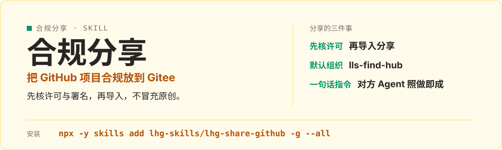

<p align="center">
  
</p>

# lhg-share-github · GitHub 项目合规分享

当用户给一个 GitHub 仓库链接、想在国内分享时使用：先核许可与署名，再默认走 Gitee 组织镜像导入，验收后交付 Gitee 链接与克隆命令，不走 GitHub 组织、不冒充原创。

## 它是什么

- 三件事缺一件都不算完成：合规存到 Gitee 组织（默认 `lls-find-hub`），对外只发 Gitee 链接；存之前先研究项目，知道它到底怎么安装、怎么启动、启动后应该打开什么；成功后返回一句话 Agent 分享指令，对方 Agent 只凭这一句就能下载、安装并打开项目。
- 研究不清启动方式时改用兜底句，不编一个看起来能跑的命令。
- 默认不走 GitHub 组织，不把代码复制成新仓冒充原创，不改上游代码，不删 LICENSE。

## 先试一句

| 你说 | 它给你 |
|---|---|
| 使用 $lhg-share-github，把 https://github.com/Renhuai123/ziwei-doushu 放到 Gitee 分享 | 核许可 → Gitee 组织导入 → 交付 Gitee 链接与一句话分享指令 |
| 这个 GitHub 项目怎么分享给国内用户 | 先核实许可、版权人、数据集许可、非商用部分，拆开写，不混成一句可商用 |
| 对方 Agent 只凭一句话能装好吗 | 验收通过才交付：按一句话指令下载、安装并打开成功 |

## 安装

```bash
npx -y skills add lhg-skills/lhg-share-github -g --all
```

<details>
<summary>发给 Agent 的安装话术（推荐：小白用户直接复制整段发给你的 Agent）</summary>

> 请帮我安装 Skill「lhg-share-github」：先从 Gitee 上 lhg-skills 组织下的 lhg-share-github 仓库下载；如果 Gitee 无法访问或下载失败，改从 GitHub 上 lhg-skills 组织下的同名仓库下载。按当前 Agent 的规范安装其中的 Skill，优先全局安装，保留完整目录和依赖。请直接执行，完成后验证是否安装成功，告诉我实际使用的来源、安装的版本号以及如何调用；遇到访问或安装限制请说明具体原因。需要输入管理员密码或确认风险时停下来等我。

**怎么算装好了**：Agent 能在已安装的 Skill 里看到 `lhg-share-github`，并报出版本号（与仓库 `SKILL.md` 的 `version` 一致）。只是打开了仓库网页不算安装。

</details>


## 它怎么做

1. 核实上游许可、版权人、数据集许可、非商用部分（拆开写）
2. 浏览器登录 Gitee，确认组织存在、账号是成员且有建仓权限（组织不存在且用户没有说先创建时先停下问）
3. 从组织页新建开源仓，用「从 URL 导入」填入 GitHub 地址导入
4. 按模板改描述（镜像收藏、原作者、许可、不改代码、不声称原创）
5. 验收后交付 Gitee 链接与一句话分享指令

## 什么时候用 / 不用

**用它，当你：**

- 给国内用户分享 GitHub 公开项目
- 对方打不开 GitHub、不用 VPN 也要能拿到
- 要合规镜像，不冒充原创

**别用它，当你：**

- 直接复制代码建新仓冒充原创
- 许可没核实就导入
- 启动方式不清楚还编命令——用兜底句

## 目录结构

```
README.md
skills/
  lhg-share-github/
    SKILL.md        skill 全文
```

## 自检与反馈

本仓库没有脚本冒烟测试；自检方法是按 SKILL.md 走一遍：许可拆开写清、组织与权限先确认、导入后验收（能按一句话指令下载、安装并打开）再交付。

发现问题请提 issue：[提一个 issue](https://github.com/lhg-skills/lhg-share-github/issues/new)（标题以 `[QC] ` 开头，写清你让它做了什么、它实际给了什么）。

本仓库目前没有单独的 LICENSE 文件；导入的项目保留上游 LICENSE，不声称原创。

---

## 出品：刘洪光

本 skill 由真人出镜 IP「刘洪光」（安徽合肥）出品，归属 [lhg-skills](https://github.com/lhg-skills)。

- GitHub 主页：https://github.com/lhg-skills —— 全部 skill 开源在此，欢迎 star
- 抖音：搜「刘老师讲AI实战」
- 微信：lhgsmsw

觉得有用，欢迎点 ⭐ Star。
