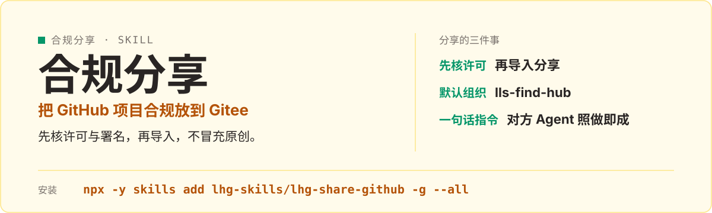

<p align="center">
  
</p>

# lhg-share-github · GitHub 项目合规分享

当用户给一个 GitHub 仓库链接、想在国内分享时使用：先核许可与署名，再默认走码云（Gitee）组织镜像导入，验收后交付**无链接坐标**与一句话 Agent 分享指令，不走 GitHub 组织、不冒充原创。同一上游再次调用时先对账，有更新就同步镜像并刷新那句话里的版本号与安装命令，避免下游拿到的指令过期。

## 它是什么

- 四件事缺一件都不算完成：合规存到码云组织（默认 `lls-find-hub`）；存之前先研究项目，知道它到底怎么安装、怎么启动、启动后应该打开什么；把同一句无链接安装指令写进镜像仓 README 顶部，让后来打开仓库的人也能看到；成功后返回一句话 Agent 分享指令，对方 Agent 只凭这一句就能找到仓库、下载、安装并打开项目。
- **分享指令里没有任何链接**：只给「平台＋组织＋仓名」坐标，由接收方 Agent 自己拼出地址。这样过聊天软件、企业 IM、Agent 平台输入框的链接拦截也不会被截断。
- 寻址阶梯压缩进句子本身：市场搜索 → 坐标克隆 → SSH 兜底 → 站内搜索 → 报告卡点，因为接收方手里还没有这个 Skill，读不到 SKILL.md 里的规则。
- 研究不清启动方式时改用兜底句，不编一个看起来能跑的命令。
- **再次调用同一上游会自动对账**：读 README 里那句话旁边的对账元数据（上游 SHA、版本号、模板类型），上游没动就直接回「已是最新」；上游动了就同步镜像、按新版重新研究启动方式、重写那句话与版本号，只产生一个只动 README 的提交。下游不会拿到停在上个月版本号的指令。
- 默认不走 GitHub 组织，不把代码复制成新仓冒充原创，不改上游代码，不删 LICENSE。唯一例外是在 README 顶部插入一句话安装块（只增不改、只动 README、只产生一个追加提交）。

## 先试一句

| 你说 | 它给你 |
|---|---|
| 使用 $lhg-share-github，把 https://github.com/Renhuai123/ziwei-doushu 放到码云分享 | 核许可 → 组织镜像导入 → README 顶部写入一句话安装 → 交付无链接坐标与一句话分享指令 |
| 这个 GitHub 项目怎么分享给国内用户 | 先核实许可、版权人、数据集许可、非商用部分，拆开写，不混成一句可商用 |
| 对方 Agent 只凭一句话能装好吗 | 验收通过才交付：按一句话指令寻址、下载、安装并打开成功 |
| 链接老是被聊天软件拦掉怎么办 | 分享指令里不放链接，只放坐标，让对方 Agent 自己拼地址 |
| 我上次分享的指令，上游更新后还准吗 | 再调用一次同一个项目：自动对账，上游没动就回旧句说「已是最新」，动了就同步镜像、刷新版本号与命令 |

## 安装

```bash
npx -y skills add lhg-skills/lhg-share-github -g --all
```

<details>
<summary>发给 Agent 的安装话术（推荐：小白用户直接复制整段发给你的 Agent）</summary>

> 请帮我安装 Skill「lhg-share-github」：先看你这边有没有自带的 Skill 市场或搜索，有就直接搜这个名字装上；没有就去国内的码云这个开源代码托管平台上，找组织 lls-find-hub 下的公开仓库 lhg-share-github（具体地址你自己按平台规则拼出来，别问我要），克隆下来后整个仓库根目录就是一个 Skill，把它整个放进你的全局 Skill 目录，确认能读到 SKILL.md 且 name 是 lhg-share-github、版本是 2.2.0 就算装好；要是访问不通，先换 SSH 方式再试，还不行就在平台站内搜组织名加仓名，都不行就停下来告诉我卡在哪一步，不要编一个地址糊弄我。

**怎么算装好了**：Agent 能在已安装的 Skill 里看到 `lhg-share-github`，并报出版本号（与仓库 `SKILL.md` 的 `version` 一致）。只是打开了仓库网页不算安装。

</details>


## 它怎么做

1. 核实上游许可、版权人、数据集许可、非商用部分（拆开写）
2. 浏览器登录码云，确认组织存在、账号是成员且有建仓权限（组织不存在且用户没有说先创建时先停下问）
3. 从组织页新建开源仓，用「从 URL 导入」填入 GitHub 地址导入
4. 按模板改描述（镜像收藏、原作者、许可、不改代码、不声称原创），末尾加一句「一句话安装见仓库 README 顶部」
5. 生成那一句无链接安装指令，写进 README 顶部（只增不改，只产生一个追加提交）
6. 验收后交付**无链接坐标**与一句话分享指令（与 README 里那句逐字一致），并分别报快照 SHA 与交付 SHA
7. 再次调用同一上游时先对账：读块内 meta 的上游 SHA 与版本号，没更新就回旧句并说明已是最新，有更新就同步镜像、重算句子与版本号，只产生一个只动 README 块的提交

## 什么时候用 / 不用

**用它，当你：**

- 给国内用户分享 GitHub 公开项目
- 对方打不开 GitHub、不用 VPN 也要能拿到
- 要合规镜像，不冒充原创
- 分享通道会拦 HTTP 链接（聊天软件、企业 IM、Agent 平台输入框）
- 上游还会继续更新，不想让分享出去的版本号停在上个月

**别用它，当你：**

- 直接复制代码建新仓冒充原创
- 许可没核实就导入
- 启动方式不清楚还编命令——用兜底句

## 目录结构

```
README.md
SKILL.md                 skill 全文（扁平布局，仓库根即 Skill 目录）
assets/readme/hero.svg   README 头图
```

## 无链接分享指令长什么样

发给对方 Agent 的一句话（模板 B，普通项目）：

> 请去国内的码云这个开源代码托管平台上，找组织 lls-find-hub 下的公开仓库 ziwei-doushu（具体地址你自己按平台规则拼出来，别问我要），克隆紫微斗数开源排盘引擎，不要用 GitHub 原地址，进入 ziwei-doushu 目录后依次执行 npm ci 和 npm run dev 完成安装并启动，然后在浏览器打开本机 3000 端口的 chart 页面让我看到排盘演示，遇到问题先做冒烟测试定位原因，直到把问题解决、能正常启动进入项目为止。

整句没有协议头、没有域名、没有 `.git`、没有 `@`，也没有 ASCII 的 gitee 字样；但「平台＋组织＋仓名」三要素齐全，接收方 Agent 自己就能拼出地址。

同一句话会原样写进镜像仓 README 顶部的「一句话安装」一节（用 `one-line-install` 注释包住）。那一节后面还附一条给人直接复制的克隆命令，并标明「不要贴进聊天软件」——它的用途只在仓库页面里，复制进聊天框一样会被拦。

## 再次调用同一上游：自动对账与刷新

一句话安装块里带一段对账元数据，记下生成这句话时的上游基线。它不发给任何人，只给下一次调用做判断：

```markdown
<!-- one-line-install:meta v1
upstream: lls-teach/lls-pptx
upstream-branch: main
upstream-sha: 8db7e410077fd7aec0962bbb7de384c206d7e482
skill-version: 1.8.0
command: 模板 A
updated-at: 2026-11-16
-->
```

（`skill-version` 是示例值，实际以该上游 `SKILL.md` 的 `version` 为准；上游未标版本或普通项目写 `none`。）

再调用同一个上游时：

| 对账结果 | 它会怎么做 |
|---|---|
| 上游 HEAD 与记录的 SHA 相同 | 不提交、不同步，把 README 里那句原样回给你，说明已是最新 |
| 上游前进了，但版本号与安装启动方式没变 | 同步镜像，只把 meta 里的 SHA 与日期更新，句子逐字不变 |
| 版本号或安装启动命令变了 | 同步镜像，按新版重新研究启动方式，重写那句话与版本号，只产生一个只动 README 的提交 |

重点是**每次都重算句子再比较**：版本号没变不代表安装命令没变，跳过这一步就会出现「版本对得上、命令跑不通」的假刷新。旧仓（v2.2 之前导入）没有这段 meta，第一次回访会先重建基线，不会假装旧句一定与上游一致。

## 自检与反馈

本仓库没有脚本冒烟测试；自检方法是按 SKILL.md 走一遍：许可拆开写清、组织与权限先确认、导入后验收（能按一句话指令寻址、下载、安装并打开）再交付。

发现问题请提 issue：[提一个 issue](https://github.com/lhg-skills/lhg-share-github/issues/new)（标题以 `[QC] ` 开头，写清你让它做了什么、它实际给了什么）。

本仓库目前没有单独的 LICENSE 文件；导入的项目保留上游 LICENSE，不声称原创。

---

## 出品：刘洪光

本 skill 由真人出镜 IP「刘洪光」（安徽合肥）出品，归属 [lhg-skills](https://github.com/lhg-skills)。

- GitHub 主页：https://github.com/lhg-skills —— 全部 skill 开源在此，欢迎 star
- 抖音：搜「刘老师讲AI实战」
- 微信：lhgsmsw

觉得有用，欢迎点 ⭐ Star。
